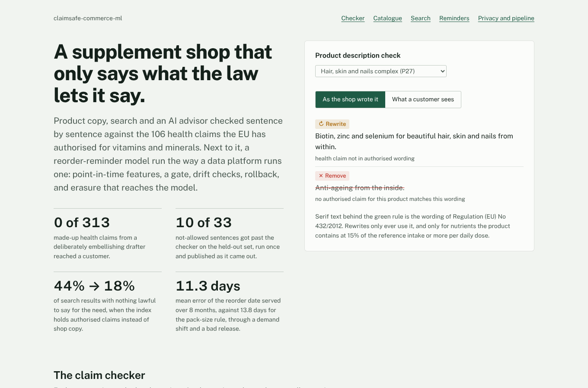
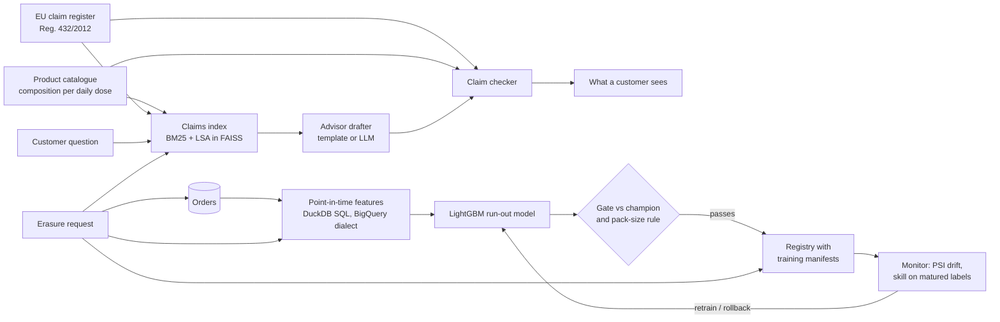

# claimsafe-commerce-ml

ML for a supplement shop, built around the rule that governs everything it says: in the EU, a food supplement may
only make the health claims listed in Regulation (EU) No 432/2012, in that wording, and only if the product contains
enough of the nutrient. This repository holds that rule as data and puts it in front of every place where text
reaches a customer: product copy, search and an AI advisor. Next to it is a reorder-reminder model, run the way a
central data platform runs one, with point-in-time features, a gate, drift checks, rollback and GDPR erasure that
reaches the model. The training steps compile to a Vertex AI pipeline and run under Prefect.



## Dashboard

Every number comes from `reports/*.json`, written by `scripts/run_benchmarks.py` and `scripts/evaluate_claims.py`.
`RESULTS.md` has the full tables.

| | Result |
|---|---|
| Claim register | **106** authorised claims for **14** nutrients, transcribed from the annex of Reg. 432/2012 |
| Checker, held-out set (written first, run once) | **85.7%** accuracy on 70 sentences (95% CI 75.7–92.0%); **10 of 33** not-allowed sentences let through, **0 of 37** allowed sentences flagged |
| Checker, dev set (tuned on) | 53 of 53 |
| Catalogue audit | **22 of 40** product descriptions need a change; **17** contain text that must be removed |
| Search, top 5 of 30 customer questions | recall **47% → 84%**, precision **45% → 80%** when the index holds what may lawfully be said instead of shop copy |
| Results with nothing lawful to say for the need | **44% → 18%** |
| Advisor guard | **0 of 313** made-up health claims from a deliberately embellishing drafter reached a customer |
| Run-out model at release | mean error **8.2 days** vs 11.2 for the pack-size rule; reminders after the customer already ran out **3.9%** vs 16.8% |
| 8-month replay with a demand shift and a bad release | served error **11.3 days** vs 13.8 for the rule; 3 drift retrains, 1 automatic rollback |
| GDPR erasure | 3 customers removed from identities, orders, features and the vector index; the one model version that learned from them retrained and purged; audit afterwards: **0** |
| Tests | 26 Python, 7 web; CI on GitHub Actions, the same checks in `bitbucket-pipelines.yml` |

## How it fits together



### The claim checker (`src/claimsafe/checker.py`)

Each sentence of a description is split and matched against the claims for the nutrients the product actually
contains at a qualifying amount: 15% of the reference intake per daily dose for "source of", and the specific daily
amounts the register sets for EPA/DHA and others, with their required statements. The verdicts:

- **Allowed**: the sentence is an authorised claim (or an approved paraphrase) for a qualifying nutrient.
- **Rewrite**: a health claim close enough to an authorised one; the suggestion is the register's own text.
- **Remove**: a medicinal claim (prevents, cures, treats, banned by Reg. 1169/2011 Art. 7(3)), or a health claim
  with no authorised counterpart for this product.

The checker is deterministic code with its vocabulary in `data/claims/policy.yaml`. A regulatory reviewer still
signs off on copy; the checker decides what reaches that reviewer and what never reaches a customer.

### Search and the advisor (`search.py`, `advisor.py`)

Customers ask about needs ("always tired", "for my heart"), and shop copy answers in marketing language. Indexing
the authorised claims each product qualifies for, rather than its copy, nearly doubles recall and precision and
cuts results the shop could not lawfully recommend for that need from 44% to 18%. A hybrid with LSA vectors in a
FAISS index changed nothing worth having on these 30 questions; products with no eligible claim never rank in it.

The advisor drafts with a template, or with an LLM through the Anthropic Messages API, and every draft passes the
checker before it is shown. The benchmark uses a drafter that embellishes on purpose (rewrites claims into marketing
language, adds benefits nobody asked for) at 20%, 50% and 80% rates: 313 made-up sentences, none shown.

### Reorder reminders, operated (`replenish/`)

A simulated shop: 6,000 customers with different adherence, subscriptions, promotions and churn, 35,752 orders over
20 months. The model predicts days until a customer runs out, so a reminder can go out five days before. Features
are written once as DuckDB SQL over orders strictly before each order and transpiled to BigQuery with sqlglot
(`pipelines/features.bigquery.sql`).

In month 15 a new acquisition channel arrives and a price rise makes customers stretch packs by a quarter. The
replay (`replenish/monitor.py`) runs month by month:

- PSI on every feature; drift for two months running triggers a retrain candidate.
- Skill is the ratio of model to rule error on the labels matured so far. Raw error is biased (early labels are the
  short run-outs) and the ratio cancels that.
- A candidate is promoted only through the gate. In month 17 a release that skipped the gate (trained on corrupted
  labels) is deployed; in month 18 it is detected and rolled back automatically, then a gated retrain replaces it.

### GDPR (`gdpr.py`, `warehouse.py`)

The warehouse knows customers only by an HMAC pseudonym; the identity table is separate. Erasure deletes identity,
orders, features and the personalisation vector (checked against FAISS's id map, not a reconstruction), and marks
every model version whose training manifest names the customer for retraining within 30 days. After the retrain,
superseded versions are purged and the audit finds nothing.

### The pipeline (`pipeline/`)

`steps.py` holds the steps as plain functions. `vertex.py` wraps them as KFP v2 components and compiles
`pipelines/replenishment.yaml` (CI checks it is up to date); `flow.py` runs the same steps as a Prefect 3 flow,
which is how the benchmark runs them. `bitbucket-pipelines.yml` mirrors the CI and has a manual step that submits the
spec to Vertex AI when credentials are configured.

## The held-out rule

The 70 held-out sentences were written and hashed before the checker had run on anything. The vocabulary was tuned
on the 53 dev sentences only; the checker, register, policy, catalogue and config were then pinned in
`config/heldout.lock`, and the held-out set was run once. Its ten misses are published as they came out: implied
claims such as "Calms your nerves after a long day", "Glow from within" and "Cleanses your liver", with no nutrient
or function word the vocabulary knows. Fixing them needs a broader implied-claim detector and a new held-out set;
this one is spent. The lock's later re-pins are listed, with reasons, in the file and in `AGENTS.md`.

## Run it

```bash
pip install -e ".[dev]"
make test lint lock-check
make bench report          # about a minute; rewrites reports/, RESULTS.md and the dashboard data
make api                   # FastAPI: /api/check, /api/search, /api/advise
cd web && npm ci && npm run dev
```

```bash
curl -s localhost:8000/api/check -H 'content-type: application/json' \
  -d '{"product": "P05", "text": "Magnesium contributes to a reduction of tiredness and fatigue. It cures insomnia."}'
```

## Limits

- Products, customers and orders are invented. The claim register is real but covers 14 nutrients; botanical
  claims, still on hold in the EU, are treated as having none.
- The held-out checker set is spent, and its false-pass rate (10 of 33) is the honest number for implied claims.
- The Vertex AI spec is compiled and checked, not submitted; there is no live Google Cloud project behind it. The
  BigQuery SQL is transpiled and parsed, not run against BigQuery.
- When two marketing sentences map to the same authorised claim, the customer-safe text repeats it (product P02).
  Deduplicating is a one-line change held for the next checker round, since the checker is pinned.
- This is not legal advice.
